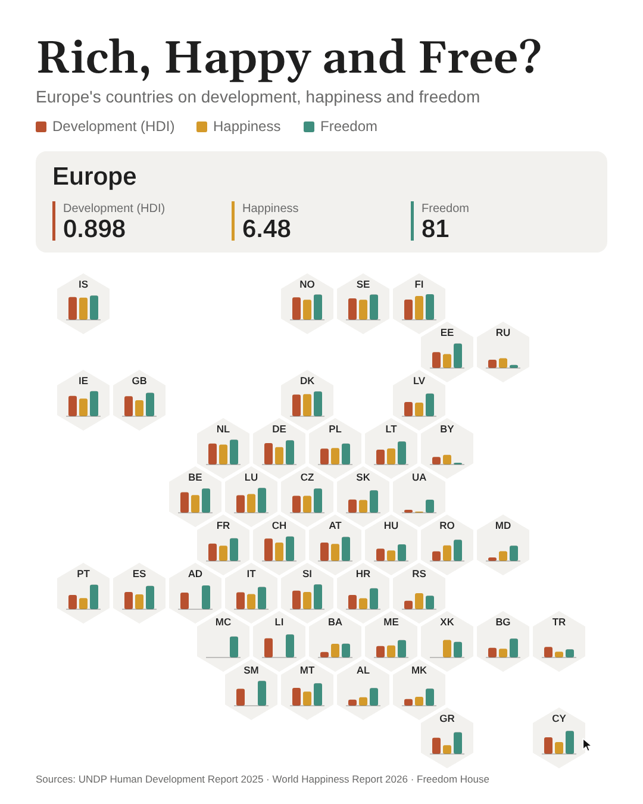

# Rich-Happy-and-Free---Hexbin-Map-Data-Viz

# Rich, Happy and Free?

**An interactive hex-tile map of Europe comparing every country on development, happiness and freedom.**

---

## Overview

Wealth alone doesn't make a country a good place to live. This project asks a broader question: **can you live well, do you feel good about your life, and are you free?** It places three widely respected indexes side by side for 46 European countries, so you can see at a glance which countries do well on all three, and where they diverge.

Each country is a hexagon, roughly where it sits on the map of Europe. Inside each hexagon, three small columns show its scores:

| Column | Index | What it measures |
|---|---|---|
| Terracotta | **Human Development Index (HDI)** | Life expectancy, education and income per person |
| Ochre | **Happiness** | How people rate their own lives, on a 0–10 ladder |
| Verdigris | **Freedom** | Political rights and civil liberties, 0–100 |

A panel above the map shows **Europe's averages** by default. Hovering over (or tapping) a country outlines it and switches the panel to that country's three numbers.

## Data

| Index | Source | Year | Coverage |
|---|---|---|---|
| HDI | UNDP *Human Development Report 2025* | 2023 values | 44 of 46 (no Monaco, Kosovo) |
| Happiness | *World Happiness Report 2026*, via Our World in Data | 2023–2025 average | 42 of 46 (no Andorra, Monaco, Liechtenstein, San Marino) |
| Freedom | Freedom House *Freedom in the World*, via Our World in Data | Latest available (2025) | All 46 |

- **Freedom score** = political rights (0–40) + civil liberties (0–60).
- **Belarus:** its latest happiness score is from 2021.
- **Missing data** shows as no column on the map and a dash in the panel.

## Visualisation

### Findings

- **The Nordics, the Netherlands and Switzerland** have three tall columns. They score highly on everything.
- **Russia, Belarus and Türkiye** score reasonably on development but very low on freedom: rich-ish, but not free.
- **Ukraine** has the lowest happiness score in Europe, and a freedom score held down by war and martial law.
- **Portugal and Greece** are free and well developed, but noticeably less happy.

---

## Sources

- UNDP, *Human Development Report 2025*, composite indices time series — hdr.undp.org
- Helliwell, Layard, Sachs et al., *World Happiness Report 2026* — worldhappiness.report (data via ourworldindata.org)
- Freedom House, *Freedom in the World* — freedomhouse.org (data via ourworldindata.org)
- D3.js v7 — d3js.org
